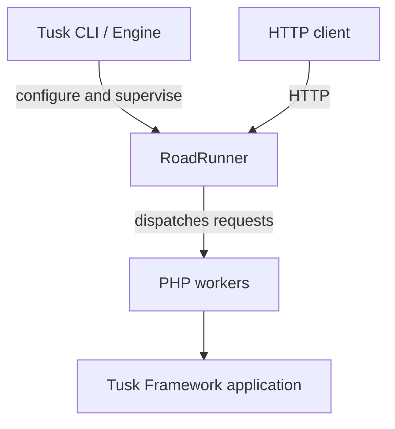

# Tusk Engine Control Plane

The Tusk Engine is a Go control plane for a Tusk application running on
RoadRunner. It validates project/runtime configuration, generates the
RoadRunner configuration at startup, starts and supervises the RoadRunner
process, and exposes operational diagnostics.

RoadRunner is the HTTP data plane and owns the PHP worker pool, request
dispatch, recycling, and worker shutdown. The Engine does not duplicate these
responsibilities or proxy application traffic.

## Project files

- `tusk.json` contains Engine/platform settings.
- `composer.json` and its lockfile contain PHP dependencies and scripts.
- `bootstrap/app.php` composes the Framework application.
- `.tusk/runtime/` contains Engine-generated runtime state; generated files are
  not application source and should not be committed.

Use `tusk doctor` to diagnose the project and `tusk start` to generate the
runtime configuration and start RoadRunner. Runtime configuration is generated
during startup; the current application workflow has no separate compile or
package-artifact phase.
